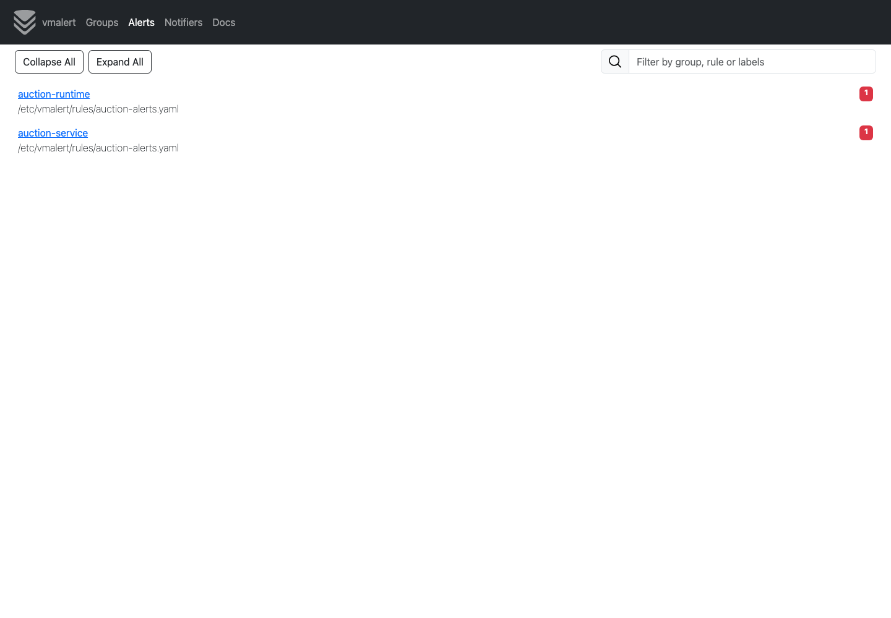
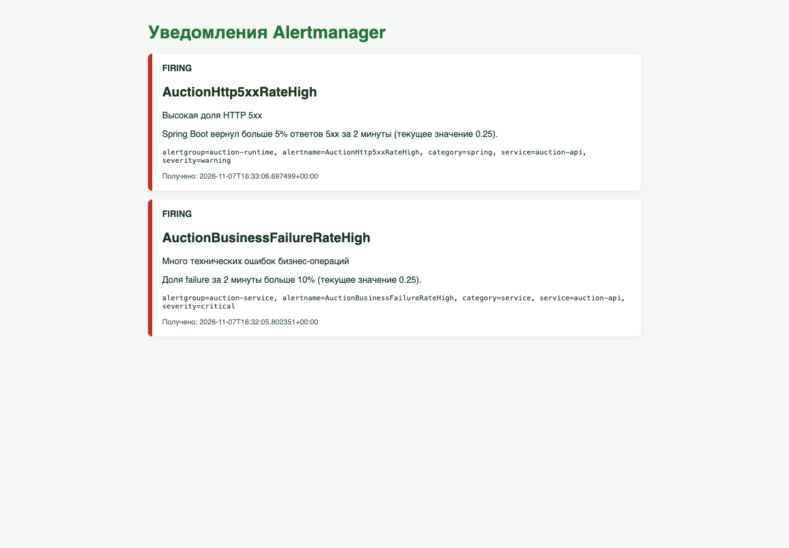

# Отчёт по алертам

## Стек

- VictoriaMetrics хранит метрики;
- `vmalert` проверяет правила раз в 15 секунд;
- Alertmanager группирует уведомления;
- webhook-приёмник показывает уведомления в браузере.

Конфигурация находится в `monitoring/alerts`.

## Алерты сервиса

### AuctionBusinessFailureRateHigh

Считает долю технических ошибок бизнес-операций:

```text
failure / (success + failure)
```

Срабатывает, если за 2 минуты выполнено хотя бы 5 операций и доля ошибок больше
10% в течение 30 секунд. Бизнес-отказы `rejected` не считаются поломкой сервиса.

### AuctionSyntheticAvailabilityLow

Считает доступность API по проверкам worker:

```text
1 - failure checks / all checks
```

Срабатывает, если за 2 минуты было хотя бы 5 проверок и доступность ниже 95% в
течение 30 секунд. Этот алерт замечает недоступность API даже без пользователей.

## Алерты Spring и JVM

### AuctionHttp5xxRateHigh

Считает долю ответов 5xx по метрике Spring Actuator
`http_server_requests_seconds_count`. Срабатывает при 20 и более запросах и доле
5xx больше 5% за 2 минуты в течение 30 секунд. Так отсеиваются единичные ошибки.

### AuctionJvmHeapUsageHigh

Считает отношение `jvm_memory_used_bytes` к `jvm_memory_max_bytes` для каждого
pod. Срабатывает, если heap заполнен больше чем на 85% в течение 2 минут. Это
может означать нехватку памяти или утечку.

## Уведомления

Alertmanager группирует алерты по имени и сервису и отправляет их в webhook.
Webhook хранит последние уведомления в памяти и показывает статусы `FIRING` и
`RESOLVED` на простой странице. Для учебного задания это не требует внешней
почты или токена мессенджера.

## Скриншоты

Активные группы правил в `vmalert`:



Уведомления о прикладном и Spring-алерте:


