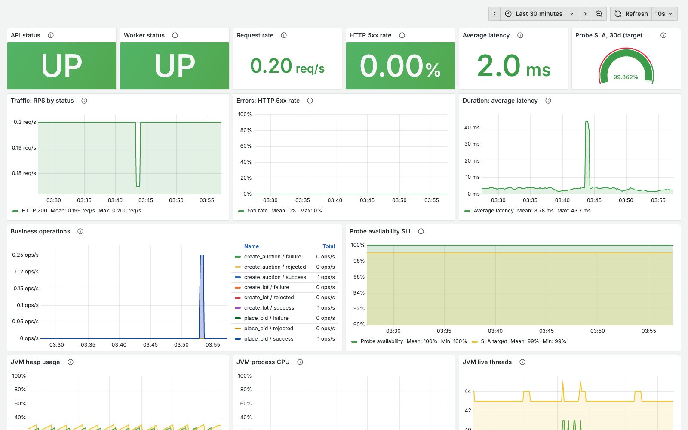
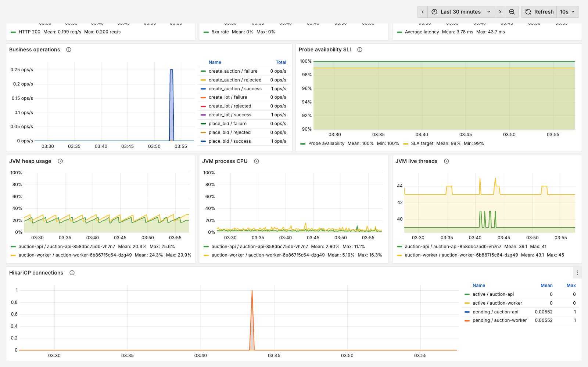
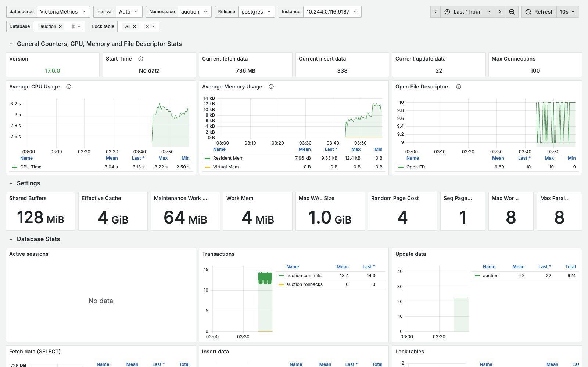

# Отчёт по Grafana

## Стек и источники данных

- Grafana 12.2.0;
- VictoriaMetrics как Prometheus-совместимый data source;
- Spring Boot Actuator и Micrometer для метрик приложения и JVM;
- отдельный пробер для проверки доступности API;
- `postgres_exporter` для метрик PostgreSQL.

Grafana и оба дашборда настраиваются файлами из `monitoring/grafana`.

## Дашборд приложения

В верхней части находятся основные показатели состояния сервиса:

- статус API и worker;
- RPS и распределение запросов по HTTP-статусам;
- доля ответов 5xx;
- среднее время ответа;
- результаты бизнес-операций: создание аукциона, лота и ставки.

Это покрывает RED и Golden Signals: нагрузку, ошибки, задержку и доступность.



Для детализации выведены JVM heap, CPU процесса, число потоков и состояние
пула соединений HikariCP. Эти панели помогают понять причину ухудшения сервиса.



## SLA пробера

Пробер регулярно вызывает API. SLA за 30 дней считается по request-based
подходу:

```text
SLA = успешные проверки / все проверки * 100%
```

Целевое значение — не ниже 99%. Значение вынесено в отдельную gauge-панель,
рядом есть график SLI и линия цели.

## PostgreSQL Exporter

Импортирован community dashboard №9628 и подключён к тому же VictoriaMetrics.
Он показывает доступность PostgreSQL, настройки, соединения, транзакции,
операции с данными, блокировки, CPU, память и файловые дескрипторы.


